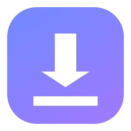
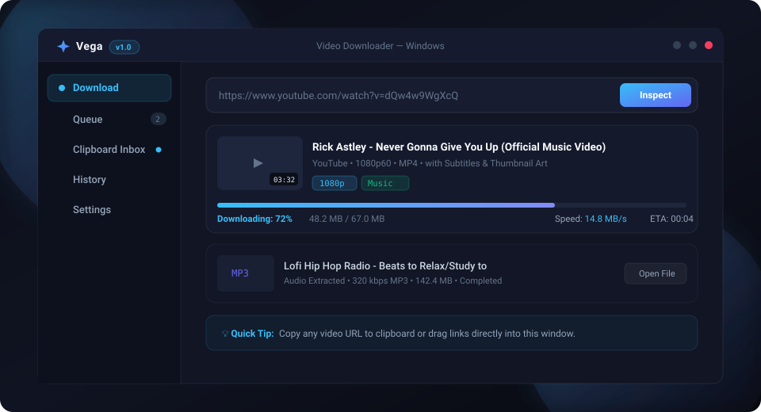
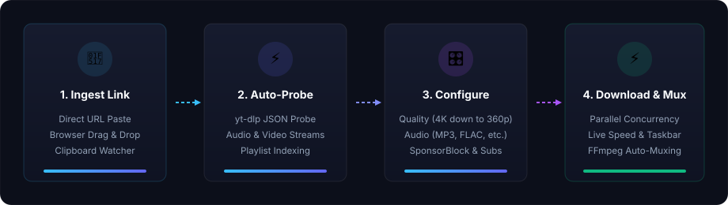

<div align="center">



# Vega

**A fast, elegant desktop video &amp; audio downloader crafted for Windows**

*Distraction-free, local-first media extraction — powered by Electron, React, TypeScript, yt-dlp, and ffmpeg.*

<p>
  <a href="LICENSE"></a>
  
  
  
  
  
  
</p>

---

<p>
  <a href="#-about-vega">About</a> •
  <a href="#-key-features">Key Features</a> •
  <a href="#-visual-tour--workflow">Visual Tour</a> •
  <a href="#-installation">Installation</a> •
  <a href="#-building-from-source">Building</a> •
  <a href="#-where-things-live">Storage &amp; Paths</a> •
  <a href="#-supported-media--formats">Supported Media</a> •
  <a href="#-design-philosophy">Design Philosophy</a> •
  <a href="#-fair-use--guidelines">Fair Use</a> •
  <a href="#-license--credits">License</a>
</p>

<picture>
  <source
    srcset="resources/vega-preview.svg"
    media="(prefers-color-scheme: dark)"
  />
  
</picture>

</div>

---

## 🌟 About Vega

Named after **Vega** (*Alpha Lyrae*), the brilliant luminary of the northern sky, **Vega** is a refined, native Windows desktop application designed for seamless media downloading and audio extraction.

Most media downloaders are either bloated with intrusive ads, locked behind subscriptions, or require wrestling with terminal commands, Python environments, and PATH variables. **Vega** provides the raw power of [yt-dlp](https://github.com/yt-dlp/yt-dlp) and [ffmpeg](https://ffmpeg.org/) through a polished, distraction-free desktop interface:

- 🚀 **Zero Configuration Required**: You do **not** need Python, yt-dlp, or ffmpeg pre-installed. Vega automatically fetches, verifies, and provisions its own isolated binaries on first run with an animated onboarding screen.
- 🪟 **Deep Windows Integration**: Engineered specifically for Windows x64 with a native frameless titlebar, taskbar progress indicators, clipboard monitoring, and a system tray daemon.
- 🎯 **Total Stream Flexibility**: Pick exact resolutions (from 4K 60fps HDR down to lightweight 360p clips) or strip audio directly to pristine MP3, M4A, Opus, FLAC, or WAV.
- 🛡️ **Local-First &amp; Privacy-Conscious**: No accounts, no telemetry tracking, and no cloud middlemen. Links you copy are merely offered—never grabbed or downloaded without your explicit confirmation.

---

## ✨ Key Features

<table>
  <tr>
    <td width="50%">
      <h3>🎛️ Smart Format &amp; Quality Picker</h3>
      <p>One-click quality chips with dynamic file size estimates, plus an advanced full stream table when you need specific video/audio codecs.</p>
    </td>
    <td width="50%">
      <h3>🎵 High-Fidelity Audio Extractor</h3>
      <p>Extract pure audio in <b>MP3</b>, <b>M4A</b>, <b>Opus</b>, <b>FLAC</b>, or <b>WAV</b> with customizable bitrates and embedded album art.</p>
    </td>
  </tr>
  <tr>
    <td width="50%">
      <h3>📑 Batch Playlist &amp; Channel Queuing</h3>
      <p>Expand entire playlists and channels, inspect individual item lengths and titles, select what you want, and enqueue everything in one click.</p>
    </td>
    <td width="50%">
      <h3>📝 Subtitles, Metadata &amp; Cover Art</h3>
      <p>Embed multi-language subtitles (VTT/SRT), thumbnail artwork, chapters, and accurate ID3/MP4 metadata directly into media containers.</p>
    </td>
  </tr>
  <tr>
    <td width="50%">
      <h3>⚡ Resilient Download Queue</h3>
      <p>Configurable concurrent downloads with live speed tracking, ETA calculations, pause/resume, retry, and per-item diagnostic logs.</p>
    </td>
    <td width="50%">
      <h3>✂️ SponsorBlock Integration</h3>
      <p>Automatically detect and remove sponsored segments, intros, outros, and subscription reminders using the SponsorBlock database.</p>
    </td>
  </tr>
  <tr>
    <td width="50%">
      <h3>📋 Clipboard Watcher &amp; Drag-and-Drop</h3>
      <p>Drop links straight from your browser onto the app window, or let the smart clipboard watcher suggest copied video links into your inbox.</p>
    </td>
    <td width="50%">
      <h3>🍪 Browser Cookie Bridge</h3>
      <p>Import session cookies from Chrome, Firefox, Edge, Brave, and other browsers with one click to download members-only and age-gated content.</p>
    </td>
  </tr>
  <tr>
    <td width="50%">
      <h3>🪟 Tray &amp; Taskbar Integration</h3>
      <p>Keep Vega running quietly in the Windows system tray. Check live download progress directly on the Windows taskbar button icon.</p>
    </td>
    <td width="50%">
      <h3>🔄 Self-Maintaining Runtime</h3>
      <p>Background yt-dlp auto-updater ensures your extractors are always up-to-date, preventing sudden breakages when platforms change their APIs.</p>
    </td>
  </tr>
</table>

---

## 📸 Visual Tour &amp; Workflow

Vega streamlines your downloading pipeline into four frictionless steps:

<p align="center">
  
</p>

### 1. Frictionless Link Ingestion
- **Drag &amp; Drop**: Drag any video link directly from your web browser into the Vega window.
- **Clipboard Watcher**: When enabled, Vega detects media links copied to your Windows clipboard and places them into a gentle **Clipboard Inbox** tab—ready to inspect whenever you choose.
- **Direct Paste**: Paste any URL into the prominent top search bar for instant processing.

### 2. Instant Background Probing
As soon as a link is entered, Vega triggers a non-blocking background probe. By the time you open the download dialog, available formats, resolutions, stream sizes, and subtitles are already loaded and ready.

### 3. Precision Configuration
- Switch between **Video** and **Audio-only** modes instantly.
- Choose your target destination subfolder using built-in **Categories** (e.g. *Music*, *Tutorials*, *Archive*).
- Toggle subtitle embedding, cover art embedding, and sponsor segment removal.

### 4. Resilient Queued Execution
Downloads run through a concurrency-managed pipeline. Vega provides:
- Live download speeds (e.g. `14.8 MB/s`) and remaining time estimates (`ETA: 00:04`).
- Windows taskbar progress fill to monitor downloads while working in other apps.
- Instant access to completed downloads with one-click folder opening and player launch.

---

## 🚀 Installation

### Ready-to-Run Binaries

Download the latest release for **Windows x64**:

| Package Type | File | Description |
| :--- | :--- | :--- |
| **Windows Installer** | `VideoDownloader-1.0.0-x64.exe` | Standard NSIS installer with Start Menu and Desktop shortcuts |
| **Portable Executable** | `VideoDownloader-1.0.0-portable.exe` | Standalone portable executable — run directly from a USB stick |

### First-Launch Experience

Vega is fully self-contained:
1. Launch the application.
2. The initial startup screen verifies dependencies and automatically provisions clean, isolated copies of `yt-dlp.exe` and `ffmpeg.exe`.
3. Once completed, Vega opens immediately and is ready to download.

---

## 🛠️ Building from Source

### Prerequisites

- **Windows 10 / 11 (x64)**
- **Node.js 20+** (LTS recommended)
- **npm** or **pnpm**

### Build Steps

1. **Clone the repository:**
   ```bash
   git clone https://github.com/projectGloria/Vega.git
   cd Vega
   ```

2. **Install dependencies:**
   ```bash
   npm install
   ```

3. **Run in development mode (with hot-reload):**
   ```bash
   npm run dev
   ```

4. **Compile and package Windows distribution:**
   ```bash
   npm run dist
   ```

   This compiles the TypeScript code, bundles the React 19 UI with Vite, and invokes Electron-Builder to generate both the installer and portable binaries in the `dist/` directory:
   - `dist/VideoDownloader-1.0.0-x64.exe`
   - `dist/VideoDownloader-1.0.0-portable.exe`

---

## 📂 Where Things Live

Vega maintains clean application isolation and stores runtime files inside your Windows user profile at `%APPDATA%\VideoDownloader\`:

| Directory / File | Purpose |
| :--- | :--- |
| `bin\` | Isolated `yt-dlp.exe` and `ffmpeg.exe` binaries provisioned on first launch |
| `cache\` | Media extractor cache (automatically pruned to save disk space) |
| `logs\main.log` | Diagnostic application log — check here if an extraction or download fails |
| `settings.json` | User configuration (accent color, default codecs, download directories, flags) |
| `queue.json` | Persistent download queue state (survives app restarts and crashes) |
| `history.json` | Completed download history records |
| `clipboard-inbox.json` | Captured clipboard links pending user action |

> [!TIP]
> **Default Download Path**: Downloads land in `%USERPROFILE%\Downloads\VideoDownloader\`. You can customize this path and set category subfolders anytime in **Settings**.

---

## 🌐 Supported Media &amp; Formats

Powered by yt-dlp, Vega supports **thousands** of video, audio, and streaming websites, including:

- **Video Platforms**: YouTube, Vimeo, Dailymotion, Rumble, Odysee, Bitchute, Streamable, Internet Archive, TED
- **Live Streams**: Twitch, Kick
- **Social Media**: TikTok, Instagram, Twitter / X, Facebook, Reddit, Bluesky, Threads
- **Audio Hosts**: SoundCloud, Bandcamp, Mixcloud
- **Output Formats**: MP4, WebM, MKV, MP3, M4A, Opus, FLAC, WAV

---

## 🎨 Design Philosophy

<p align="center">
  
</p>

> *"A bright four-point star illuminating media streams — modern, focused, and distraction-free."*

Vega's visual language was designed to match modern Windows styling:
- **Celestial Star Identity**: The four-point Vega brand mark dynamically inherits your chosen theme accent gradient.
- **Ambient Glow Backdrop**: Subtle radial color blooms illuminate dark slate surface layers with zero visual clutter.
- **Ergonomic Typography**: Space Grotesk display headings paired with crisp Inter body typography.
- **Customizable Themes**: Choose from curated accent palettes (Electric Cyan, Indigo, Emerald, Amber, Rose) in Settings.

---

## ⚖️ Fair Use &amp; Guidelines

Vega is a media archival and retrieval tool created for content that you have the legal right to download:
- Personal backups and archival of your own uploaded content.
- Creative Commons, open-license, and public domain media.
- Educational, research, and fair-use archiving.

Please respect the terms of service of the platforms you interact with and honor the intellectual property rights of creators.

---

## 📜 License &amp; Credits

Vega is open-source software licensed under the **[MIT License](LICENSE)**.

### Built Upon Giants
- **[yt-dlp](https://github.com/yt-dlp/yt-dlp)** — The world's finest media extraction engine.
- **[ffmpeg](https://ffmpeg.org/)** — Industry standard multimedia transcoding and muxing.
- **[Electron](https://www.electronjs.org/)** &amp; **[electron-vite](https://electron-vite.org/)** — Modern cross-platform desktop framework.
- **[React 19](https://react.dev/)** &amp; **[Tailwind CSS v4](https://tailwindcss.com/)** — Responsive, performant user interface.
- **[Zustand](https://github.com/pmndrs/zustand)** — Fast, lightweight reactive state management.
